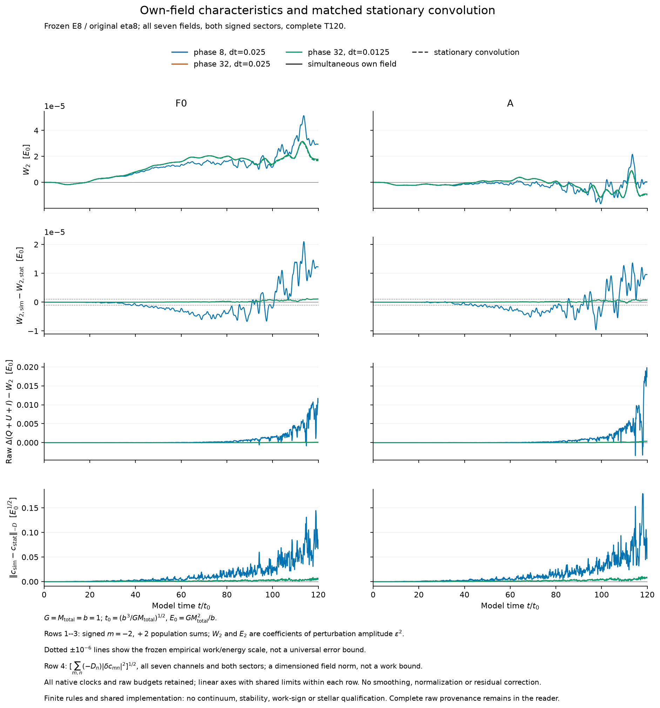
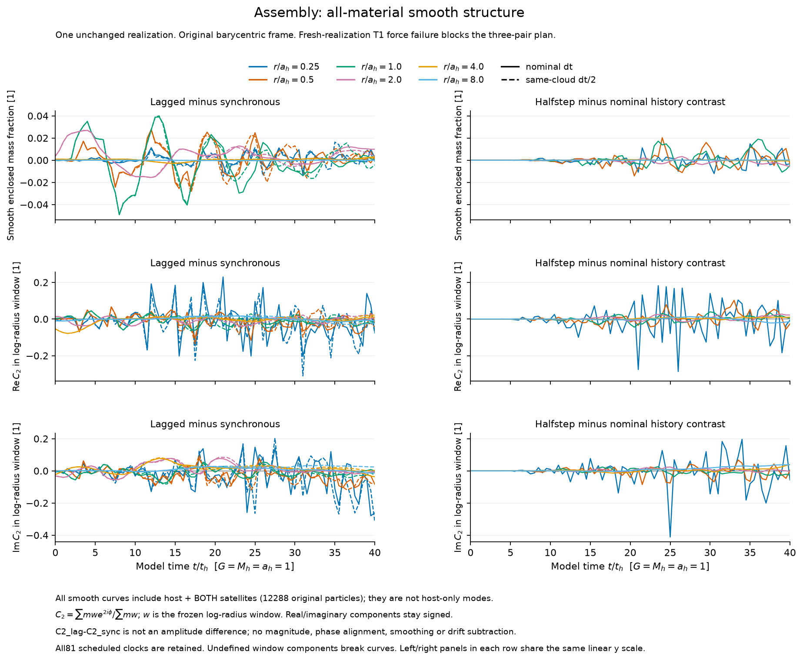
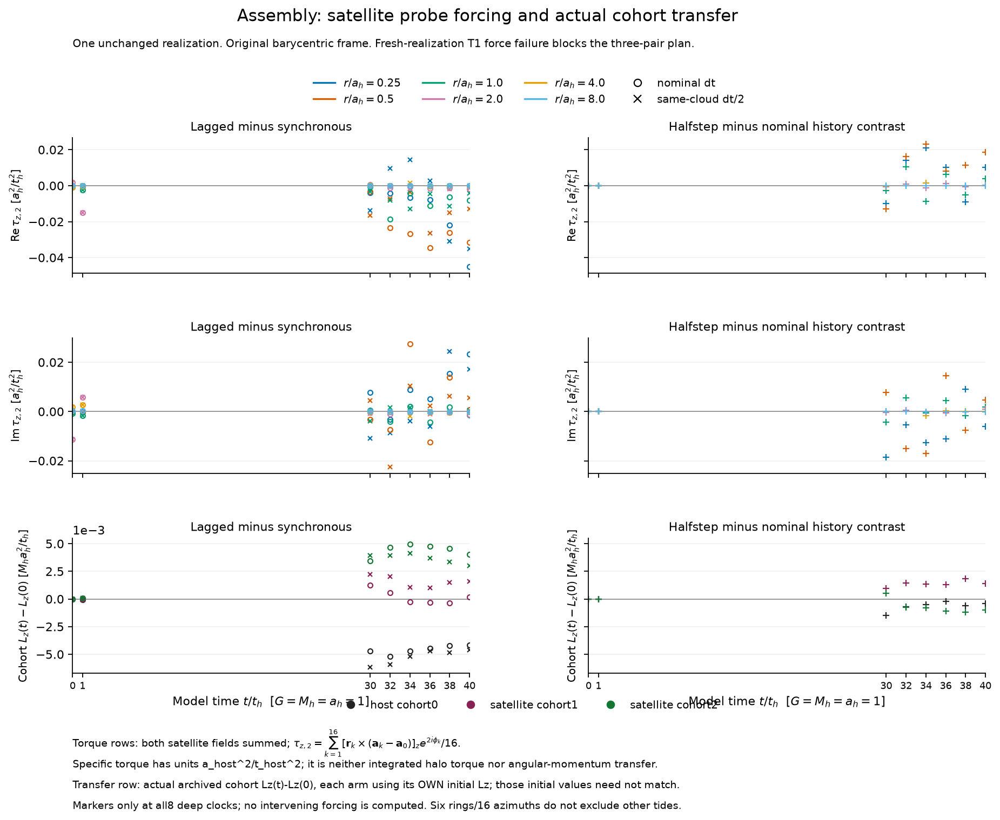

# Assembly memory, halo response, and the controls that remained missing

16 October 2026. This report closes the scientific assessment of a specified
set of tests. It does not establish the proposed galaxy-formation mechanism,
or show that halo assembly memory is absent.

A dark-matter halo's density does not specify its orbital distribution. The
question here was whether physically attainable assembly could leave orbital
organization that changes a stellar bar's evolution after ordinary density,
streaming and continuing-forcing differences have been controlled. Answering
that requires a connected argument: a trustworthy response calculation, an
attainable candidate, a discriminating control, and a qualified stellar
comparison. The completed tests supply parts of that argument, but do not
complete the connection.

| Required connection | Matched or held fixed | Measured | Still unavailable |
|---|---|---|---|
| Halo response | Population definitions, imposed perturbation and matched finite orbit rules | Prescribed-field work agreement; a collective operator discrepancy surviving timestep refinement | Qualified continuum activity, wake and energy accounting |
| Attainable preparation | Original particle clouds, masses and force law; each history repeated at half timestep | Complete opposed-accretion histories and host internal angular-momentum redistribution | Ordinary-property matching, a settled unforced candidate and independent-realization confirmation |
| Hidden organization control | Exact initial positions, masses and reversal-even empirical measure | Four positive sign constructions, each with 16 independent and balanced roundings | Matched unfitted currents and an observable-specific nuisance bound |
| Stellar consequence | A common stellar construction was sought | Field approximations were tested and their failed screens retained | Qualified common equilibrium, release and live stellar-mode comparison |
| Observational discrimination | No common observation operator was applied | No galaxy-population prediction from these tests | A distinguishing stellar or observational prediction |

[Chiba & Kataria](https://arxiv.org/abs/2311.07640) connect odd distribution-function
gradients and resonant torque to halo rotation. [Kataria & Shen](https://arxiv.org/abs/2406.17113)
show that changing the angular-momentum distribution at fixed total spin can
change bar evolution. The intended advance here required stronger ordinary-property
controls and a demonstrated preparation-to-stellar consequence. Neither general
halo phase-space sensitivity nor the entropy-based construction is claimed as new.

The response tests compared a baseline population, F0, and an engineered
population, A. A prescribed-field characteristic calculation agreed with the
archived full-history work to better than $10^{-7}$ at the tested E64 rule.
That is a useful consistency result for that observable and discretization.
It does not qualify the induced wake or a collective energy-return mechanism.

The subsequent collective comparison held the E8/eta8 action rule, all seven
radial fields and both signed azimuthal sectors fixed. Each method included
its own induced field. One projected the population at every integration
stage; the other used stationary convolution with a kernel computed from the
same initial orbit rule. The complete pulse lasted $T=120$, with pattern
speed 0.12 and rise/fall time 12. These response-model units are
$G=M_{\rm total}=b=1$; reported work and energy are coefficients of the
perturbation amplitude squared.



At phase32 and half timestep, the maximum work disagreements were
$1.2371881\times10^{-6}$ for F0 and $9.3143810\times10^{-7}$ for A.
Each operator's timestep change was below $2.96\times10^{-9}$. F0 therefore
exceeded the predeclared empirical $10^{-6}$ disagreement scale after the required
timestep discrimination. A did not trigger that particular rejection.
This rejects interchangeability at the tested finite rule; it does not identify
which operator is closer to the continuum. A's simultaneous endpoint work also
changed sign between phase8 and phase32.

The raw maximum canonical-energy-minus-work residuals remained
$1.07635\times10^{-4}$ and $3.82866\times10^{-4}$. Wake differences also
remained material. Their negative-Poisson norm has different units from work
and is not a work-error allowance. A finite initial phase rule need not remain
stationary as its orbits evolve, but this explanation was not uniquely isolated
from other representation or shared-code errors. The engineered witness was
therefore not promoted to physical self-consistent activity or stellar
amplification. [Retained response summary](evidence/simultaneous-family-summary.json).

The attainable-history experiment used a Plummer host with mass and scale
radius one, represented by 8192 particles, and two 2048-particle Plummer
satellites, each of mass 0.025 and scale radius 0.1. The global P1 softening
was 0.0025. Satellite centres used host-monopole apocentre 3 and pericentre
0.5. Both satellites were present initially: the lagged case advanced the
second satellite's orbital phase by four time units. It was not an injection
after four units of independently evolved host history.

Both histories reached $T=40$ at timesteps 0.00125 and 0.000625. All material
was retained, with 81 accounting clocks and eight deeper field/occupation
readouts. The strongest surviving result is host angular-momentum redistribution.
Removing centre-of-mass orbital motion uses the exact whole-cohort identity

$$
\boldsymbol L_{\rm internal}=\boldsymbol L_{\rm raw}
-\boldsymbol R_{\rm COM}\times\boldsymbol P.
$$

The initial host internal angular momentum agreed between histories. At $T=40$,
its change in $L_z$ was +0.0039067 versus −0.0002459 for synchronous versus
lagged at the nominal timestep, and +0.0037963 versus −0.0007770 at halfstep.
The contrast is not simply host COM motion. Internal angular momentum can
nevertheless include streams and debris; it is not proof of coherent rotation
or matched local streaming.



Detailed density and occupation patterns were more timestep-sensitive. At
radius one, the late mean mass-fraction contrast changed from −0.00377109 to
−0.00134345. The final host occupation contrasts had similar total magnitudes,
0.149414 and 0.152100, but their signed timestep difference had magnitude
0.185059 in the same full-support bins. Similar aggregate amplitudes therefore
did not establish the same orbital structure. Neither chaos nor collisional
relaxation was diagnosed as the explanation.



Persistent late satellite/debris probe fields leave continuing forcing as an
uncontrolled alternative. These are differential specific-torque fields, not
integrated host torques; their presence does not prove they explain everything.
Initial whole-system energy and vector angular momentum were not matched;
recorded history contrasts included
$\Delta E=-0.00018639453$ and $\Delta L_z=+0.00035579145$.
Conservation does not remove those confounds. The planned fresh realization
failed its original initial-force screen and was not advanced to $T=40$.
Thus the measured result is one realization at two timesteps, not replicated
hidden-memory evidence. [Assembly summary](evidence/assembly-T40-two-pair-summary.json).

The archived-state control test addressed a narrower constructive question.
For every host particle, it allowed its original velocity or its reversal at
the same position and mass. Fractional probabilities were fitted by minimizing
relative entropy with respect to equal sign probabilities, subject to 203 current
constraints: global momentum and angular momentum,
the original spatial current features, and 35 density-observer derivatives.
Held-out current features remained outside the fit. All four original endpoints
were used; satellites remained unchanged.

The fractional fitted-current residuals were $1.53\times10^{-9}$ to
$5.49\times10^{-9}$. Balanced dependent rounding reduced the worst
single-cloud fitted residuals from 0.109–0.117 to 0.0292–0.0402 across the fixed
16 seeds. Each value divides a discrepancy by that feature's sum of absolute
original particle contributions. It is neither a percentage error in a small
signed mean nor a future torque bound. The final fractional particles were
rounded without residual correction; dependent sampling does not inherit the
independent Bernoulli covariance formula.

The limitation survived that improvement. Fractional held-out midpoint-current
residuals remained 0.112–0.125. Held-out observer scales 0.8 and 1.25 gave
0.0268–0.0370 and 0.00148–0.00215. More roundings would not remove these
fractional differences. Some held-out and cubic-velocity maxima increased
under balancing. Extensive velocity reversal is itself possible for an
ordinary finite sample of an even distribution, so changed mass or entropy
does not measure assembly-generated memory.

A driven-minus-own-unforced comparison would be a legitimate response
measurement. Subtracting baseline evolution, however, does not subtract a
susceptibility change caused by different ordinary currents. Identical initial
satellite states can subsequently respond differently to the changed host too.
The sign construction preserves the initial even empirical measure and raw
kinetic energy, but it does not isolate the requested causal explanation.
[Complete construction summary](evidence/assembly-balanced-control-summary.json).

These limitations motivate the branch stops. A velocity-shift nuisance changes
even stress as well as current, unlike the sign intervention. Failure of that
one nuisance to reproduce a response would not exclude other current fields.
More diffuse progenitors are physically legitimate, but dissolution alone
would not match ordinary energy, angular momentum or streaming, and debris
could still force the halo. Alternative progenitors also do not automatically
demonstrate that a specified target distribution is reachable: collisionless
transport constrains the fine-grained distribution, while relabelling components
of an unchanged total distribution adds no gravitational information.

The common stellar model remained unqualified. Its failed field screens were
preserved, while density/action consistency, stationarity and mode accuracy
were not established by agreement between nearby field approximations. This
does not make every finite-time halo-response experiment impossible. It does
mean that no specified continuation here separates the needed ordinary
alternatives and supplies the stellar consequence. The stop is scientific and
scoped; it is not a universal null, impossibility theorem or claim that the
ultimate objective was achieved.

The [public runnable component](runner/README.md) performs **the sign construction only** from
four complete all-particle endpoint files. Each contains positions/velocities,
masses, cohort labels and particle IDs for all 12288 particles. From the
portable-code directory, with the documented NumPy/SciPy dependencies present:

```bash
python -B run.py --inputs inputs/inputs.json --output ../control-output
```

The output directory must be new. The default runs all four refits and all
16 seeds per state for independent and balanced sampling, retaining raw
moments, signs and limitations. It does not rerun assembly trajectories or
collective response. Scientific functions are extracted unchanged from the
frozen sources. A separate saved-output comparison verified exact equality of
all 1,088 numerical arrays across the complete portable and original
constructions. This is same-code software equivalence, not independent physical
validation. The figures and evidence summaries document the other completed
calculations separately.

AI assistance was used extensively for source construction, checking,
interpretation and writing. Internal agent criticism is not external peer
review; these results have not been externally reviewed. Corrections and
reproduction reports are welcome through the public
[issue tracker](https://github.com/djova/bar-halo-benchmark/issues).
